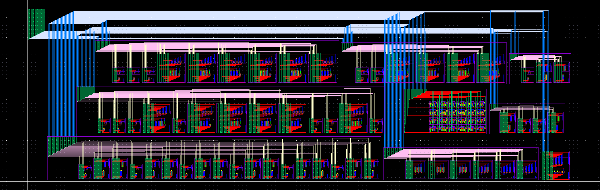

# EEE5322 — Complete GPDK045 4 × 6 SRAM

A complete 24-bit SRAM designed and validated with local Cadence Virtuoso,
Spectre, and Pegasus tools, including decoders, write driver, VDD precharge,
sense amplifier, holding latch, and physically connected array.

[Final report (PDF)](Final_Project_Report.pdf) ·
[Editable report (Word)](Final_Project_Report.docx) ·
[Full project and reproduction instructions](full_array/README.md)

- All 24 addresses pass all-one, all-zero, and explicit mixed-pattern readback at **20 MHz**.
- Nine process/temperature cases pass **852 operations**; extracted-device replay passes **268 operations**.
- All **17 cells and blocks** have **zero DRC violations** and **LVS MATCH**.
- The complete **371-transistor** layout is **131.84 × 42.05 µm (5543.872 µm²)**.
- Required 50% timing: write 1/0 **0.4152/0.2187 ns**; read 1/0 **0.3693/0.3859 ns**.

The [validation summary](full_array/results/validation_summary.json) records 101
passing checks. Timing is measured with the stated schematic loads; extracted
simulation validates device topology and does not include interconnect RC.
The report follows the supplied reference report structure; author and workload
fields are blank as requested.

| Folder | Contents |
| --- | --- |
| [full_array/](full_array/README.md) | Complete EEE5322 submission, native `sram_project` library and evidence |
| [sram_cell/](sram_cell/README.md) | Companion 6T sizing, noise margin, supply/offset sweeps, baseline comparison |
| `cds.lib` | Open both native libraries from this repository root |

The compact 6T cell follows the supplied reference image and measures
**2.12 × 1.68 µm (3.5616 µm²)**. Both it and the retained minimum-width baseline
have clean DRC/LVS. The separate [single-cell report](sram_cell/SRAM_Cell_Report.pdf)
contains 94 validated cell-study simulations and the sizing rationale.

EDA installations, GPDK045, and licenses are local external dependencies. Generated
scripts, native views, netlists, waveforms, measured tables, and verification logs
are included. See [full_array/README.md](full_array/README.md) for rerun commands.
